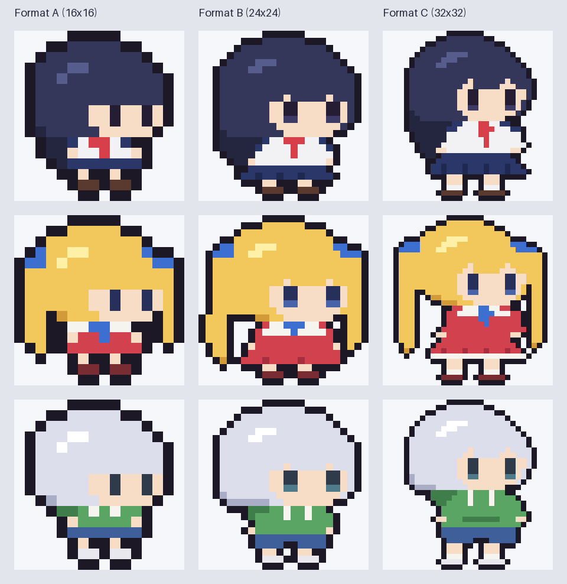

# ドット絵キャラクター作成ルール

このリポジトリのゲームで人型キャラクターを描くときは、このルールに従う。
見本は `samples/`（`sheet.png` が一覧、`sprites.py` が元データ）。**新しいキャラクターは、選んだフォーマットの見本グリッドを複製し、髪と服を描き替えて作るのが基本**。ゼロから描かない。

## 1. 何を描くか

- 描くべきキャラクターが明らかに人間で、性別や年齢などの指定が特に無い場合は**少女**として描く。
  - 指定があればそれに従う（「必ず少女」ではない）。
  - 「少女」はユーザーの好みの風合いの指定。見本の雰囲気（デフォルメされた小柄な少女）が基準。
- 少女以外の人間を描く場合も、**同じゲーム内のキャラクターはなるべく同じフォーマットに揃える**（キャンバス、頭と体の比率、目の描き方、輪郭線、向きの表現）。描き分けは髪型・髪色・服・小物・体の大きさの範囲で行う。

## 2. 全体の決まり

| 項目 | ルール |
|---|---|
| キャンバス | 正方形。画素数は粗め（16 / 24 / 32px のいずれか） |
| 向き | 元データは**右向き**。左向きは左右反転で作る。真横ではなく**斜め前向き**（3/4ビュー） |
| 輪郭線 | 塗りの外周に1pxの線を自動付与（上下左右の4近傍）。色は `#1d1826`。内側には輪郭線を引かず、色の違いで分ける |
| 余白 | 輪郭線のために、塗りは上下左右の端から1px以上離す。足の裏の輪郭線がキャンバスの最下段に来る |
| 表示 | 整数倍で拡大し、補間しない（canvasは `imageSmoothingEnabled = false`、CSSは `image-rendering: pixelated`） |

## 3. 顔

- **目にハイライトを入れない**。目は暗い色の塊で描く。B・Cは下1段だけ少し明るい色（`e`）にしてよい（ハイライトではなく色の段差）。
- 目が怖く見える場合は、縦線の目や丸い目などデフォルメ寄りにする。
- **頬の赤み（ピンクなど）は入れない**。
- **鼻と口は基本的に描かない**。そのぶん目を少し下に置く（前髪のすぐ下に目、目の下の顔は1〜2段）。
- 斜め前向きの表現：
  - 頭の左側（後頭部側）は髪の塊、顔は頭の右寄りに置く。
  - 手前の頬（左の目の左側）は2px、奥の頬（右の目の右側）は1〜2px。
  - B・Cは奥の頬の外側に1pxの髪を入れて、顔の輪郭を作る。
  - 前髪の下端に、肌がのぞく隙間を1〜2か所入れる（B・C）。

## 4. フォーマット

ゲームごとに1つ選び、そのゲームの人型キャラクターはすべて同じフォーマットで描く。座標は0始まり（x=列、y=行）で、見本の値。

| | A | B | C |
|---|---|---|---|
| キャンバス | 16×16 | 24×24 | 32×32 |
| 頭（y） | 1〜9 | 1〜14 | 1〜16 |
| 体（y） | 10〜14 | 15〜22 | 17〜30 |
| 頭身の目安 | 約1.6 | 約1.6 | 約1.9 |
| 頭の最大幅（x） | 2〜13 | 3〜21 | 5〜27 |
| 目の大きさ | 1×2（縦線） | 2×3（下1段が `e`） | 2×4（下1段が `e`） |
| 目の位置 | x=9, 12 / y=7〜8 | x=12〜13, 18〜19 / y=10〜12 | x=16〜17, 23〜24 / y=11〜14 |
| 顔の肌（x） | 7〜13 | 10〜20 | 14〜26 |
| 脚・足 | 脚1段、靴1段（つま先を右に1px） | 脚1段、靴1段（靴3px幅） | 脚2段、靴下1段、靴1段 |
| 向いている用途 | 画面に多数並ぶ、マップを歩く小さなキャラ | 標準。アクション・パズルの主役など | 大きめに見せる、服の描き込みが要る（会話・選択画面など） |

選び方の目安：迷ったらB。キャラクターがタイルと同じ大きさで並ぶならA。キャラクターを大きく見せたい、服装の違いで見分けさせたいならC。

## 5. 色

- 1キャラクターあたり10色前後。文字の割り当ては見本に合わせる：

| 文字 | 用途 | 見本の例 |
|---|---|---|
| `H` / `h` / `j` | 髪 / 髪の影 / 髪のつや | 影 `h` は顔より下に垂れる後ろ髪や髪の裾に使う。つや `j` は頭頂の左寄りに2〜4pxの斜めの筋 |
| `S` | 肌 | 全員共通 `#f7dcc6` |
| `E` / `e` | 目 / 目の下段 | 髪色に合う暗い色 |
| `W` / `C` / `c` / `R` / `D` | 白い布 / 服の主色 / 服の影 / アクセント / ボトムス | |
| `K` | 靴 | |

- 影は主色より暗く、少しだけ彩度を上げる。
- 黒髪は輪郭線と区別がつくよう、紺寄りの明るめの色にする（見本 `#34365a`）。
- 新しい文字が必要なら追加してよいが、輪郭線用の `O` と透明の `.` は予約。

## 6. 作業の手順

1. フォーマットを決め、`samples/sprites.py` の同じフォーマットのグリッドを複製する（髪型が近いキャラクターを選ぶ）。
2. 髪と服の部分を描き替え、パレットを作る。顔のパーツ（目の位置・大きさ・頬）と体の骨格はフォーマットのまま動かさない。
3. `tools/render.py`（`sprite_image`, `sheet`）でPNGに出力し、**画像を自分の目で確認してから**使う。崩れていたら直す。
4. ゲームでは、グリッドとパレットをHTMLに埋め込み、`tools/sprite.js` の `makeSprite()` を貼り付けて描く（輪郭線と左向きはこの関数が作る）。

## 7. 道具

- `tools/render.py` — Python（Pillow）。`outline()`、`to_image()`、`sprite_image(grid, palette)`、`sheet(rows)`
- `tools/sprite.js` — ブラウザ用。`makeSprite(grid, palette)` → `{ right, left }` の等倍canvas
- `samples/build.py` — 見本のPNGと一覧を再生成（`python3 -B docs/pixel-art/samples/build.py`）
